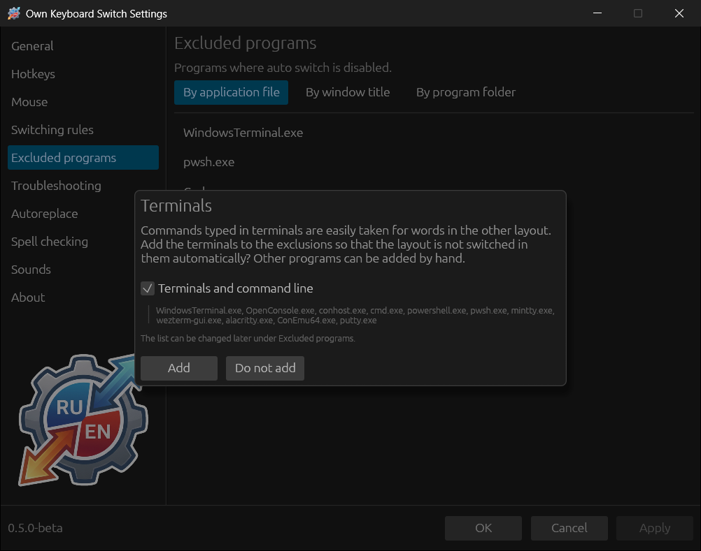
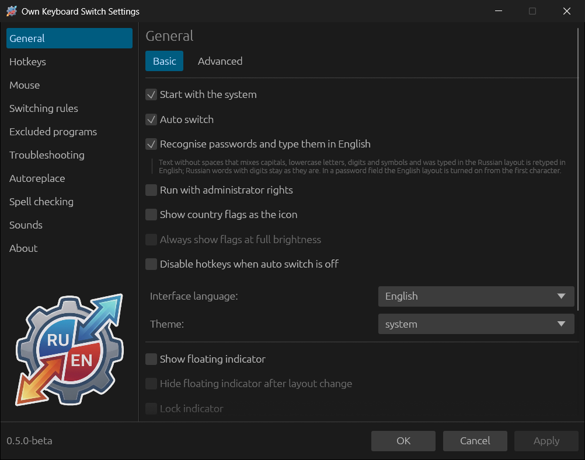

# Quick start

## 1. Start the program

After start, an icon with the current layout appears in the notification
area. If you cannot see it, it may be hidden under the “Show hidden icons”
arrow; drag it to the taskbar to see the layout at all times.

On the first run on Windows the program offers to add terminals to the
exclusions:

Commands typed in terminals are easily taken for words in the other layout.
**Add** turns auto switch off in Windows Terminal, PowerShell, the command
prompt and the other listed programs. **Do not add** keeps it everywhere; then
a command typed in the wrong layout is corrected before Enter reaches the
terminal. The list can be changed later in
[Excluded programs](08-rules-and-exclusions.md#excluded-programs).

## 2. Try it

Open any text editor, turn on the English layout and type `ghbdtn` and a
space. The word is erased, the layout switches to Russian, and the screen
shows `привет `. The other direction works the same way: `руддщ` → `hello`.

Press **Break** (Pause on many keyboards) right after the correction: the
program restores the word as it was, and the layout too. Press Break after a
word the program left alone, and it converts it to the other layout.

## 3. Open the settings

Double-click the tray icon (in KDE Plasma, click once) or choose
**Settings...** in its menu.

Changes are applied with **Apply** or **OK**; **Cancel** closes the window
without saving. Worth looking at first:

- **General → Basic** — autostart, flags in the tray, the window language and
  theme;
- **Hotkeys** — if Break is inconvenient or missing on your keyboard;
- **Excluded programs** — programs where switching is not needed (games,
  remote desktops, code editors).

## 4. If a word was corrected wrongly

- Press **Break** — the correction is undone.
- Undo the same word twice in a row — the program offers to add a rule so it
  is left alone from then on. See
  [Switching rules](08-rules-and-exclusions.md#switching-rules).
- Why a word sometimes stays as it is — see
  [How auto switch works](04-how-switching-works.md#when-the-program-does-not-intervene).
