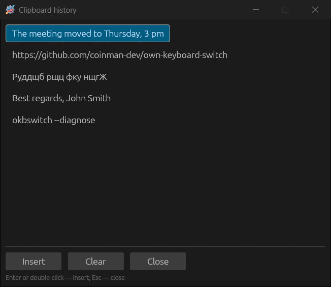

# Everyday use

## Tray icon

The icon shows the current layout: the letters **RU**/**EN** or, if **Show
country flags as the icon** is on, a flag. When auto switch is off, the icon
turns grey or dim, and the tooltip adds “(auto switch off)”.

- **Double-click** — open the settings. In KDE Plasma the settings open with a
  single click; in GNOME the menu opens with a single click and the settings
  with a double click.
- **Single click** (Windows) — the [autoreplace](09-autoreplace.md#list-and-insert-menu)
  insert menu, if **Show the list in the menu** is selected in its settings.
- **Right click** — the menu:

| Item | What it does |
|---|---|
| **Settings...** | Opens the settings window |
| Layout list | All layouts installed in the system, with flags; a click turns a layout on |
| **System keyboard settings** | Opens the system section for languages and layouts |
| **Auto switch** | Turns auto switch on and off |
| **Sound effects** | Turns [sounds](11-troubleshooting-sounds-about.md#sounds) on and off |
| **Clipboard →** | **Change layout**, **Transliterate**, **Check spelling** of the text in the clipboard; **View history...** |
| **Autoreplace →** | **Autoreplace list** and, if enabled, the entries themselves — a click inserts the text |
| **About** | Version, license, component licenses |
| **Exit** | Closes the program |

## Floating indicator

**General → Basic → Show floating indicator** displays a small layout icon on
top of the windows.

The indicator does not take the focus: you can drag it with the mouse while
typing in another window. Right click — the menu **Lock indicator**,
**Settings...**, **Hide indicator**; a double click opens the settings. With
the **Hide floating indicator after layout change** option it appears for a
couple of seconds after each layout change and then hides.

## Actions on selected text

Select text in any program and press the key combination. The program copies
the selection, converts it and pastes it back; the previous clipboard contents
are restored.

| Default combination | Action | Example |
|---|---|---|
| **Shift+Break** | Change layout of selected text | `Ghbdtn? rfr ltkf&` → `Привет, как дела?` |
| **Alt+Break** | Change case of selected text | `hELLO` → `Hello` |
| **Alt+Scroll Lock** | Transliterate selected text | `Привет` ↔ `Privet` |
| **Ctrl+Alt+V** | Paste text without formatting | Pastes the clipboard as plain text |
| not set | Convert number to words | Russian words only: `458` → `Четыреста пятьдесят восемь`, `247-23` → `Двести сорок семь рублей 23 копейки` |
| not set | Add selected text to autoreplace | Opens a new autoreplace entry with this text |

The combinations are changed in the [Hotkeys](07-hotkeys-and-mouse.md)
section.

## Clipboard

The same conversions work on text already copied to the clipboard: the tray
menu **Clipboard → Change layout / Transliterate / Check spelling** or the
“Change clipboard layout” and “Transliterate clipboard text” hotkeys. The
result is put back into the clipboard; if **Show clipboard conversion result
window** is on ([General → Advanced](06-general-settings.md#advanced)), it is
also shown in a window with a **Copy result** button.

### Clipboard history

While **Watch the clipboard** is on, the program remembers the last 30 copied
texts. The history window opens with the tray menu item **Clipboard → View
history...** or with the “Show clipboard history” hotkey.

Enter or a double click pastes the selected entry into the window where you
were typing; **Clear** forgets all entries; Esc closes the window. Text copied
again moves to the top of the list.

By default the history lives only until the program exits. The **Keep
clipboard history after restart** option writes it to the
`data\clipboard-history.txt` file. The contents are not filtered: a copied
password ends up in the file too, so turn it on deliberately.

## Comma on double Space

With the **Comma on double Space** option, pressing Space twice quickly after
a word inserts a comma and a space — handy in the Russian layout, where the
comma needs Shift.
