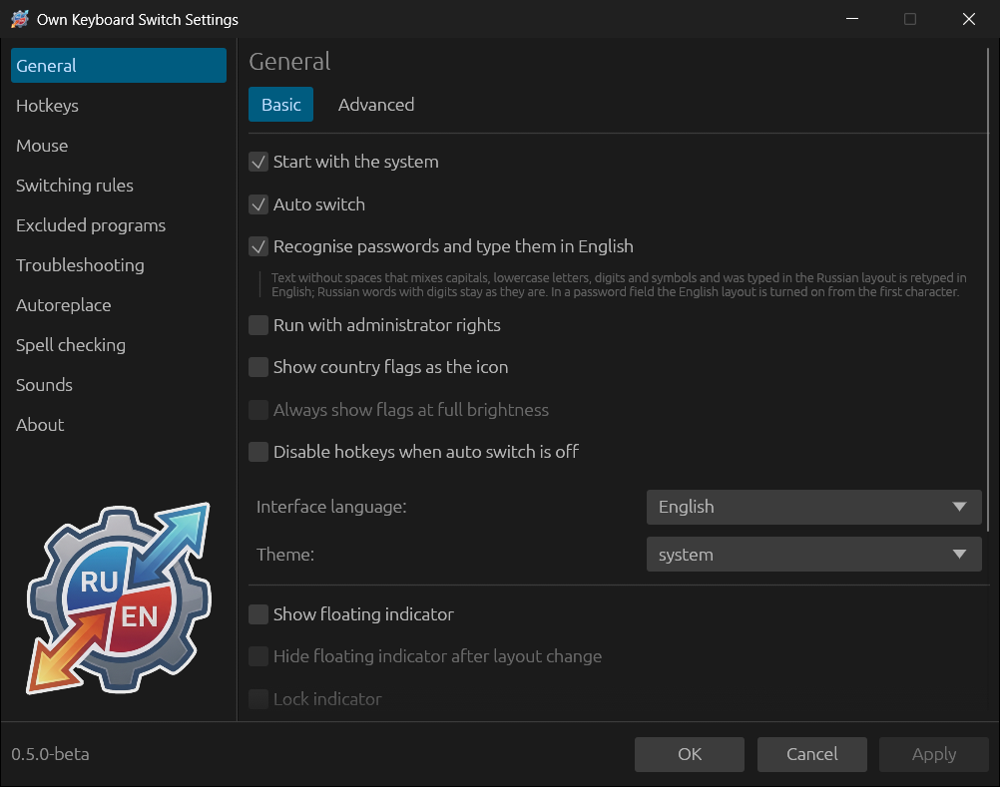
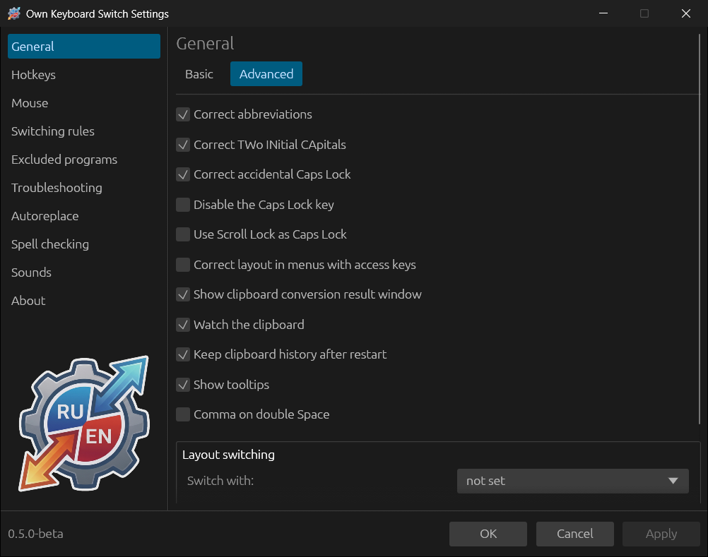
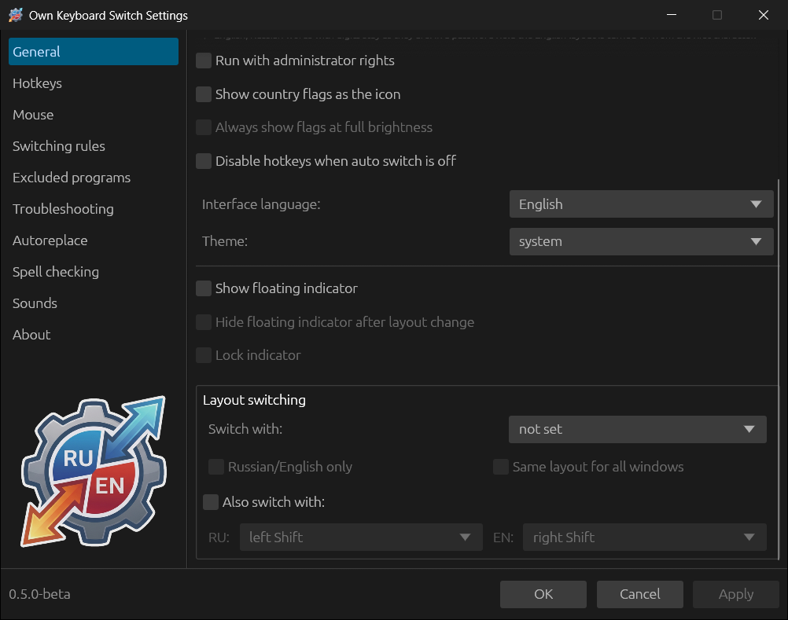

# General settings

The **General** section has the **Basic** and **Advanced** tabs; on Linux
there is also a **Linux** tab. Below both of the first tabs is the **Layout
switching** block.

## Basic

| Option | Default | What it does |
|---|---|---|
| **Start with the system** | on | Start at logon. On Windows — an entry in the user's startup list, on Linux — a file in `~/.config/autostart/` |
| **Auto switch** | on | The main switch for automatic correction. Break and the other hotkeys work without it as well |
| **Recognise passwords and type them in English** | on | See [Passwords](04-how-switching-works.md#passwords) |
| **Run with administrator rights** | off | Windows only. Needed for the program to work in windows running as administrator. After **Apply** the program offers to restart with a single UAC prompt. With autostart, the registration moves to Task Scheduler so that UAC does not ask at logon |
| **Set up keyboard access on startup** | on | Linux only. If there is no keyboard access, the setup window opens at startup |
| **Show country flags as the icon** | off | A flag instead of the RU/EN letters in the tray. Below it the **Flag for each layout** list appears — you can choose a flag for each installed layout |
| **Always show flags at full brightness** | off | Do not dim the flag when auto switch is off |
| **Disable hotkeys when auto switch is off** | off | All the program's key combinations are turned off together with auto switch |
| **Interface language** | Automatic | Russian or English; “Automatic” takes the system interface language. Changes without a restart |
| **Theme** | system | Light, dark or system |
| **Show floating indicator** | off | See [Floating indicator](05-everyday-use.md#floating-indicator) |
| **Hide floating indicator after layout change** | off | The indicator appears for 2 seconds after a layout change |
| **Lock indicator** | off | The indicator cannot be moved with the mouse |

## Advanced

| Option | Default | What it does |
|---|---|---|
| **Correct abbreviations** | on | Convert words of capital letters: `ШЫЩ` → `ISO`. Turn it off if such words are more often intentional |
| **Correct TWo INitial CApitals** | on | `HEllo` → `Hello` |
| **Correct accidental Caps Lock** | on | `hELLO` → `Hello` and Caps Lock is turned off |
| **Disable the Caps Lock key** | off | Caps Lock stops working |
| **Use Scroll Lock as Caps Lock** | off | Scroll Lock turns capital letters mode on and off |
| **Correct layout in menus with access keys** | off | Windows only. When Alt is pressed, the layout temporarily adapts to the letters of the window menu, so that Alt+Ф opens «Файл» and Alt+F opens “File”. Works in programs with a standard system menu |
| **Show clipboard conversion result window** | on | Show a window with the result after converting the clipboard |
| **Watch the clipboard** | on | Keep the [clipboard history](05-everyday-use.md#clipboard-history) |
| **Keep clipboard history after restart** | off | Write the history to a file; the contents are not filtered |
| **Show tooltips** | on | Explanations when hovering over elements of the settings window |
| **Comma on double Space** | off | Two quick spaces after a word give “, ” |

## Layout switching

The layout can be switched with a single key instead of the system key
combination.

- **Switch with:** right or left Ctrl, right or left Shift, Caps Lock, left or
  right Alt. A short press of the key on its own, without other keys, triggers
  it; in combinations the key works as usual.
  - **Russian/English only** — switch only between the Russian and English
    layouts, skipping the other installed ones.
  - **Same layout for all windows** — one layout for all windows: when you go
    to another window, the same layout is turned on there. Not supported in
    GNOME on Wayland.
- **Also switch with:** separate keys for each layout — for example, left
  Shift turns on Russian (**RU**), right Shift turns on English (**EN**).

## Linux

The tab exists only on Linux; details are in the
[Linux](12-linux.md#the-linux-tab) chapter.

- **Switching method** — “Automatic selection” (XKB in X11, GNOME or KDE
  integration in Wayland) or an explicit choice: “X11 (XKB)”, “KDE desktop”,
  “GNOME extension”. The “GNOME shortcut” and “Internal tracking” variants are
  not available yet.
- **Keyboards** — one device path per line (`/dev/input/event3` or a link
  under `/dev/input/by-id`). An empty list uses all accessible keyboards.
  Changes apply without a restart.
