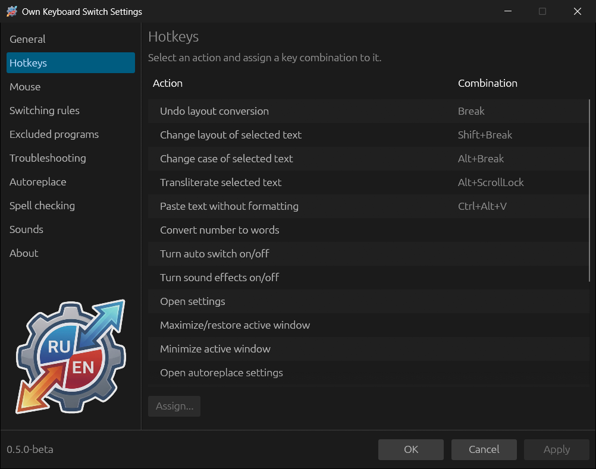
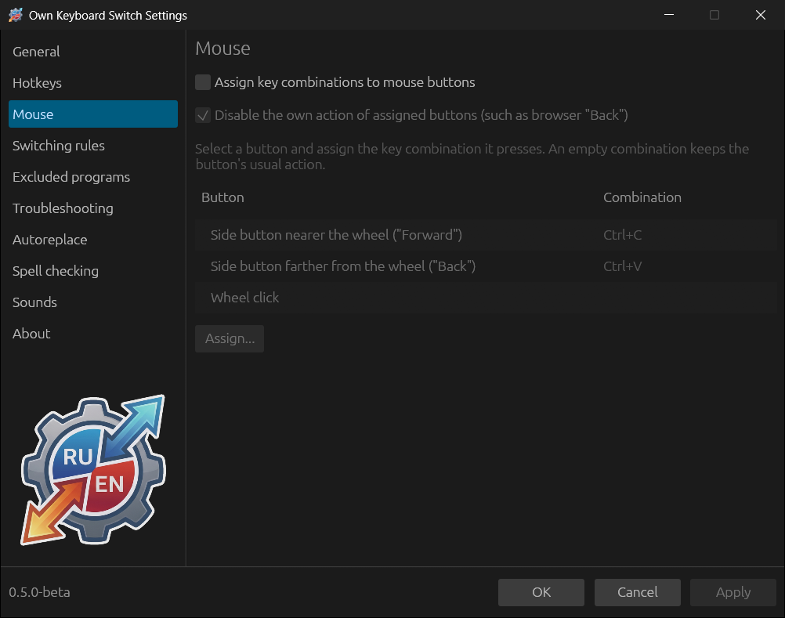

# Hotkeys and mouse

## Hotkeys

Select an action in the list and click **Assign...** (or double-click the
row). In the **Assign key combination** window press the combination you want
— **Set by pressing** — or type it, for example `Ctrl+Alt+K`. **Clear**
removes the assignment, Esc cancels. If the combination is already taken by
another action, the window warns you.

| Action | Default | What it does |
|---|---|---|
| Undo layout conversion | Break | Undoes the last correction or converts a word by hand — see [The Break key](04-how-switching-works.md#the-break-key) |
| Change layout of selected text | Shift+Break | `Ghbdtn` → `Привет` in the selection |
| Change case of selected text | Alt+Break | `hELLO` ↔ `Hello` |
| Transliterate selected text | Alt+Scroll Lock | `Привет` ↔ `Privet` |
| Paste text without formatting | Ctrl+Alt+V | Pastes the clipboard as plain text |
| Convert number to words | — | Russian words only: `458` → `Четыреста пятьдесят восемь` |
| Turn auto switch on/off | — | Same as the tray menu item |
| Turn sound effects on/off | — | Same as the tray menu item |
| Open settings | — | Opens this window |
| Maximize/restore active window | — | For any window, like the Maximize button |
| Minimize active window | — | For any window |
| Open autoreplace settings | — | Opens the Autoreplace section |
| Show/hide autoreplace list | — | A persistent list, see [Autoreplace](09-autoreplace.md#list-and-insert-menu) |
| Show autoreplace insert menu | — | Replaces the typed abbreviation or opens a choice of entries |
| Add selected text to autoreplace | — | A new autoreplace entry with the selected text |
| Show clipboard history | — | See [Clipboard history](05-everyday-use.md#clipboard-history) |
| Change clipboard layout | — | Converts the text in the clipboard |
| Transliterate clipboard text | — | Transliterates the text in the clipboard |
| Check spelling of the selection or clipboard | — | See [Spell checking](10-spellcheck.md) |

The combinations work in all programs. If **General → Basic → Disable hotkeys
when auto switch is off** is on, they do not work while auto switch is off.

Laptops often have no Break key, or it is available only via Fn. Assign
another combination to “Undo layout conversion”.

## Mouse

Mouse buttons can be given key combinations that they will “press”.

1. Select **Assign key combinations to mouse buttons**.
2. Choose a button — **Side button nearer the wheel ("Forward")**, **Side
   button farther from the wheel ("Back")** or **Wheel click** — and click
   **Assign...**. Initially Ctrl+C and Ctrl+V are suggested for the side
   buttons.
3. **Disable the own action of assigned buttons** (on) — so that, for example,
   “Back” in a browser does not go to the previous page. A button with an
   empty combination keeps its usual action.

A mouse button presses the combination for the active program. Combinations
of Own Keyboard Switch itself (such as Break) cannot be triggered this way:
the program does not process its own key presses.
