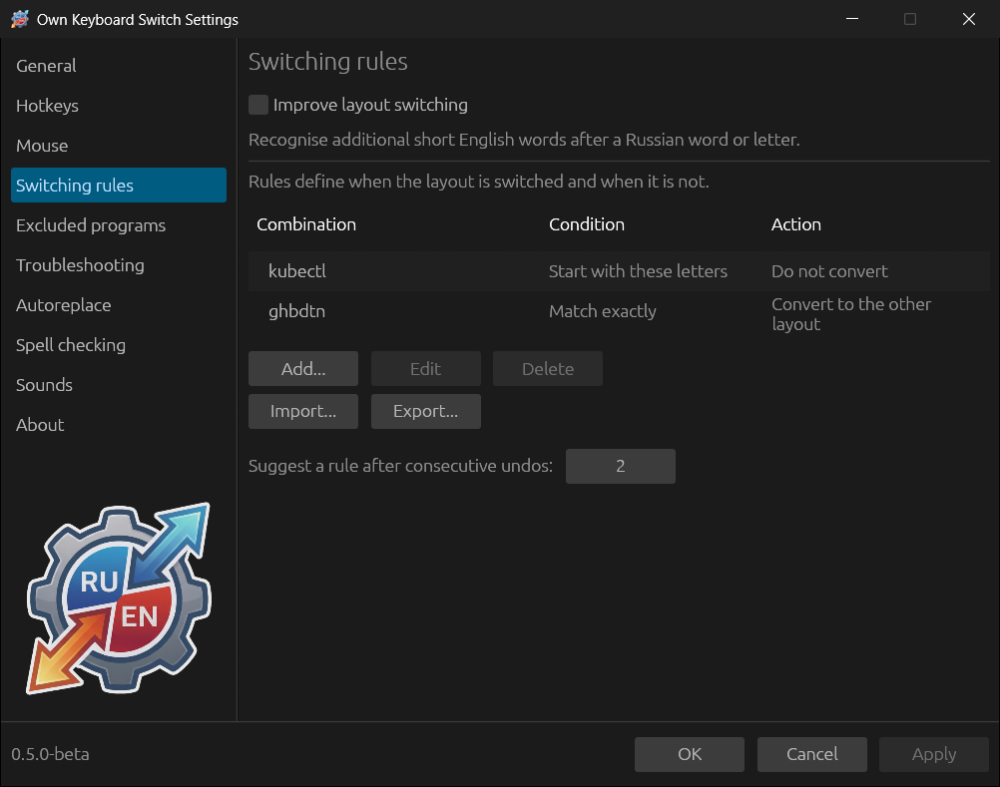
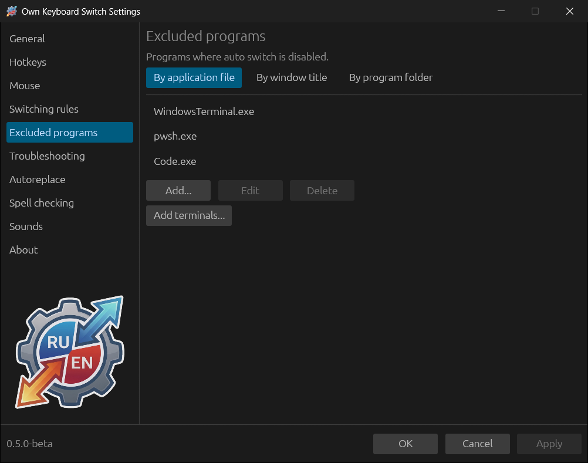

# Rules and excluded programs

## Switching rules

A rule tells the program what to do with words that contain a given letter
combination, and it acts before the dictionaries and statistics.

Click **Add...** and fill in the **Switching rule** window:

- **Word or letter combination** — in either layout: the rule is compared with
  both readings of the word, so `ghbdtn` and `привет` give the same rule.
  Tip: use the characteristic part of the word without its ending.
- **Condition** — the word must **Contain these letters**, **Start with these
  letters** or **Match exactly**.
- **Case sensitive** — if selected, `Git` and `git` are different.
- **Action** — **Convert to the other layout** or **Do not convert**.

Examples:

| Combination | Condition | Action | Why |
|---|---|---|---|
| `kubectl` | Start with these letters | Do not convert | The command and its forms stay as typed |
| `ghbdtn` | Match exactly | Convert to the other layout | Always correct this particular word |

**Edit** and **Delete** work on the selected row; double-clicking a row also
opens it for editing.

### Rule after undos

If the same word is undone with the Break key several times in a row, the
program asks: “You undid the conversion of this word several times. Add a
rule?” — and opens the rule window with the word already filled in. The
number of undos is set by **Suggest a rule after consecutive undos** (2 by
default).

### Import and export

**Export...** saves the rules to a TOML file, **Import...** adds rules from
such a file to the list: new ones are added, matching ones are updated. You
can also import a whole `config.toml` of another installation — only the
rules are taken from it. After importing, click **Apply**.

### Improve layout switching

**Improve layout switching** (at the top of the section, off by default)
additionally recognises short English words of 2–3 letters after a Russian
word or a single letter: `я купил шыщ` → `я купил iso`. Russian words, names
and titles are protected. User rules take precedence over this option.

## Excluded programs

In programs from this list automatic corrections are not made: auto switch,
case correction, password retyping. Hotkeys (Break, Shift+Break…) keep
working — unless **Troubleshooting → Do not interact with excluded programs**
is on.

A program can be specified in three ways — on the tabs:

| Tab | What to enter | Example |
|---|---|---|
| **By application file** | File name or full path. A name without a path matches the program in any folder. Case does not matter | `WindowsTerminal.exe`, `C:\Games\game.exe` |
| **By window title** | Part of the window title, **case-sensitive** | `Visual Studio Code`, `- Remote Desktop` |
| **By program folder** | A folder: all programs in it and in its subfolders are excluded | `D:\Games` |

**Add terminals...** opens the same offer as on the first run: Windows
Terminal, OpenConsole, conhost, cmd, PowerShell, pwsh, mintty, WezTerm,
Alacritty, ConEmu and PuTTY.

What is usually added: games (where keys are controls, not text), remote
desktops and virtual machines (they have their own layout), code editors if
you mostly write code in them.

On Linux, programs are identified by the executable file name or the window
app_id. In GNOME on Wayland this requires the GNOME Shell extension that comes
with the program; without it the section shows a warning.
