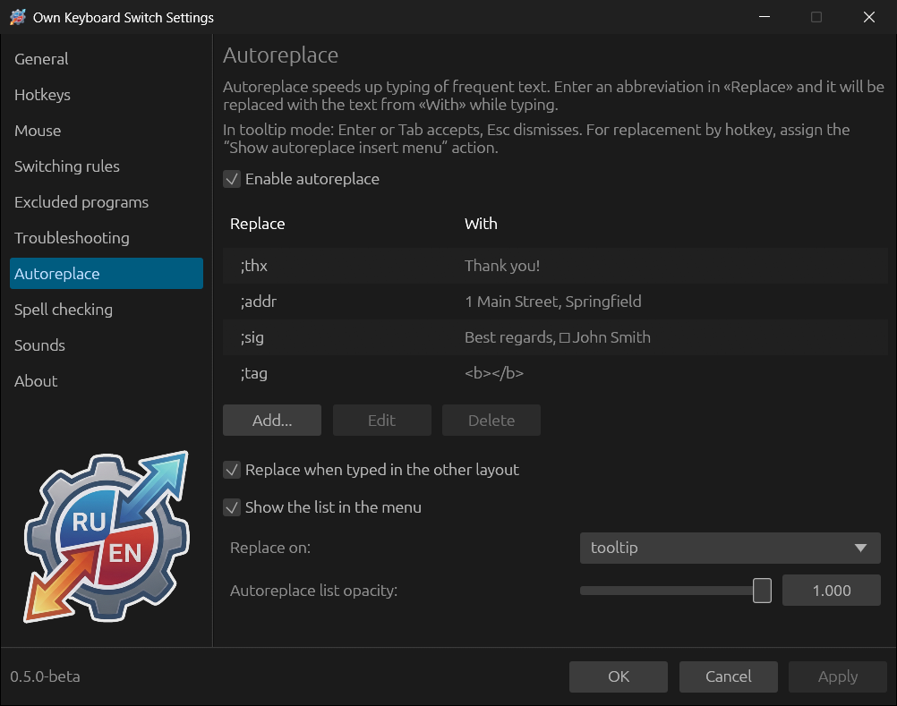
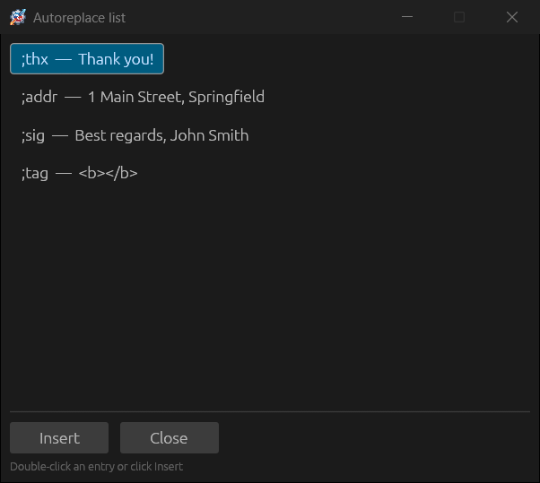
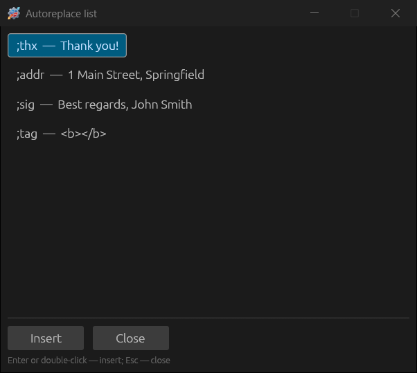

# Autoreplace

Autoreplace expands abbreviations into ready-made text: type `;addr` and get
the whole address. It is off by default.

## Entries

Select **Enable autoreplace** and click **Add...**. In the entry window:

- **Replace** — the abbreviation. It is convenient to start it with a
  character that does not occur in ordinary words (`;thx`, `;addr`), so that
  the replacement does not fire by accident.
- **With** — the replacement text; it can span several lines.
- **Remember cursor position** — after insertion the caret is placed not at
  the end but at the spot in the replacement text where it was while editing
  (or set **Caret after character number**). For example, for `<b></b>` the
  caret ends up between the tags.

Entries can also be added from any program: select text and press the “Add
selected text to autoreplace” combination (assigned in
[Hotkeys](07-hotkeys-and-mouse.md)). A new entry with this text opens; all
that is left is to come up with an abbreviation.

## When replacement happens

**Replace on:**

| Mode | How it works |
|---|---|
| **tooltip** (default) | When the typed text matches an abbreviation, a tooltip with the replacement text appears next to the caret. **Enter** or **Tab** replaces, **Esc** leaves it as is. The tooltip does not take the focus |
| **Space** | The abbreviation is replaced when a space is pressed after it; the space stays after the inserted text |
| **Enter** / **Tab** | The abbreviation is replaced on Enter or Tab; the key itself is not passed to the program |
| **hotkey** | Replacement with the “Show autoreplace insert menu” combination: if an abbreviation is typed before the caret, it is replaced, otherwise a menu for choosing an entry opens |

**Replace when typed in the other layout** (on) — an abbreviation is
recognised even when typed in the wrong layout: `addr` typed in the Russian
layout looks like `фввк`, but it is replaced too.

## List and insert menu

Entries can also be inserted without abbreviations.

The **Autoreplace list** is a persistent window that does not take the focus
from your program. It opens with the tray menu item **Autoreplace →
Autoreplace list** or the “Show/hide autoreplace list” combination. A double
click on an entry or the **Insert** button inserts the text where you were
typing. **Autoreplace list opacity** is set with a slider in the settings.

The **insert menu** is a temporary selection window at the caret: the “Show
autoreplace insert menu” combination (if there is no abbreviation before the
caret) or a single click on the tray icon (Windows). **Enter** or a double
click inserts an entry, **Esc** closes the menu.

With the **Show the list in the menu** option the entries are also listed in
the **Autoreplace** tray menu: a click on an entry inserts it.

In password fields and in programs excluded with the **Do not interact with
excluded programs** option, text is not inserted.
