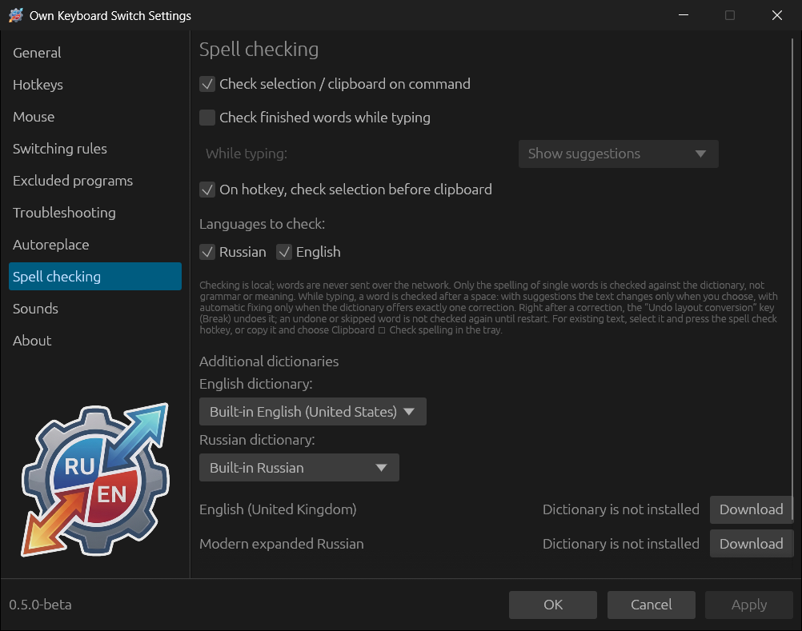
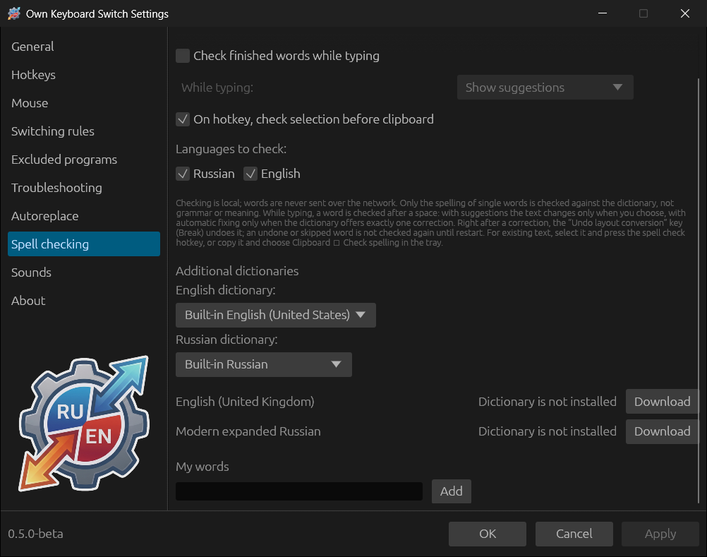

# Spell checking

Checking is done on the computer; words are not sent over the network. Only
the spelling of single words is checked against the Hunspell dictionary, not
grammar or the meaning of a phrase.

## Checking existing text

On by default (**Check selection / clipboard on command**).

- Select text and press the “Check spelling of the selection or clipboard”
  combination (assigned in [Hotkeys](07-hotkeys-and-mouse.md)). With the **On
  hotkey, check selection before clipboard** option the selection is checked,
  and if there is none, the text in the clipboard.
- Or copy the text and choose **Clipboard → Check spelling** in the tray menu.

The **Spell check** window shows the words found, with suggestions. Choose the
suggestions you want (or **Choose first suggestions**), review the **Result**
and click **Copy result** — the corrected text ends up in the clipboard.

## Checking while typing

**Check finished words while typing** (off by default) checks each word after
a space. The **While typing** mode:

- **Show suggestions** — a “Possible spelling error” window with suggestions
  appears at the caret; the text changes only if you choose a suggestion.
  **Keep unchanged**, **Skip** and **Add to my words** leave the word as is.
- **Automatically fix only unambiguous errors** — the word is corrected
  automatically, but only if the dictionary offers exactly one suggestion.

Right after a correction, Break undoes it. An undone or skipped word is not
checked again until the program restarts. In terminals words are not checked
while typing: commands and their parameters are not dictionary words.

## Languages and dictionaries

- **Languages to check** — Russian and English; you can keep just one.
- **English dictionary** — built-in English (United States) or English
  (United Kingdom).
- **Russian dictionary** — built-in Russian or “Modern expanded Russian”.

Additional dictionaries are downloaded with the **Download** button — this is
the only thing the program needs the network for. **Delete** removes a
downloaded dictionary.

**My words** — your own words that are not counted as errors: type a word and
click **Add**. Words added with the **Add to my words** button go here too.

The “Spelling error found” and “Spelling correction applied” sounds are set up
in the [Sounds](11-troubleshooting-sounds-about.md#sounds) section.
