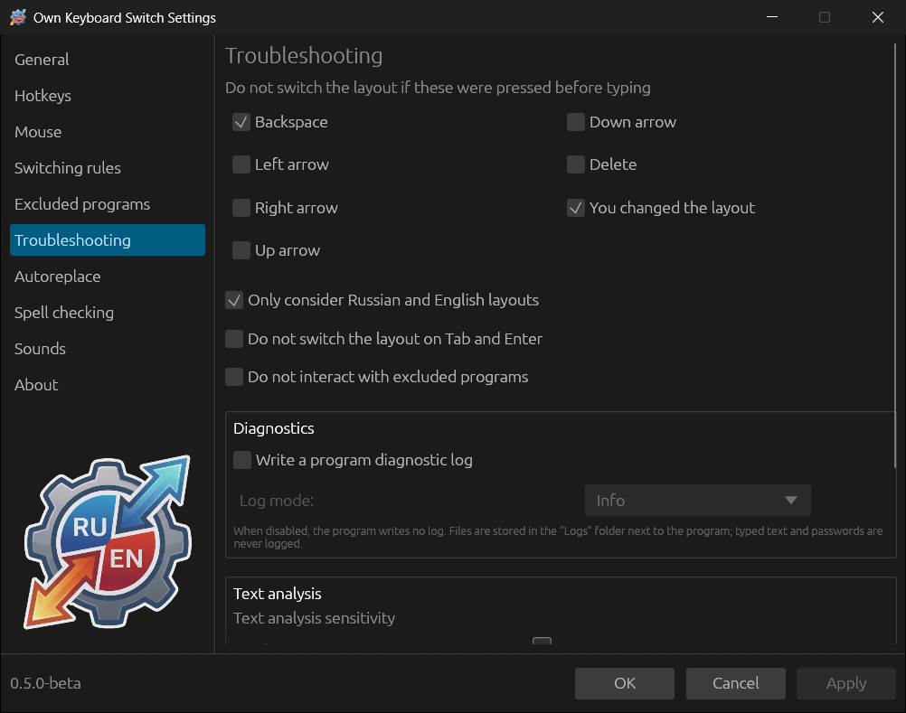
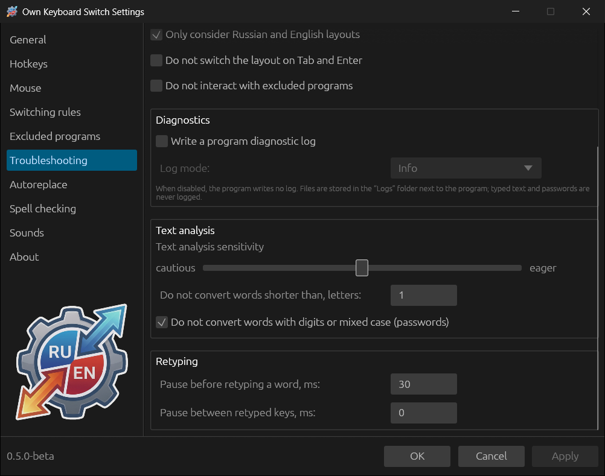
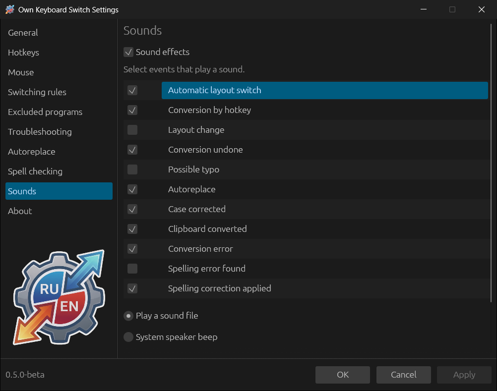
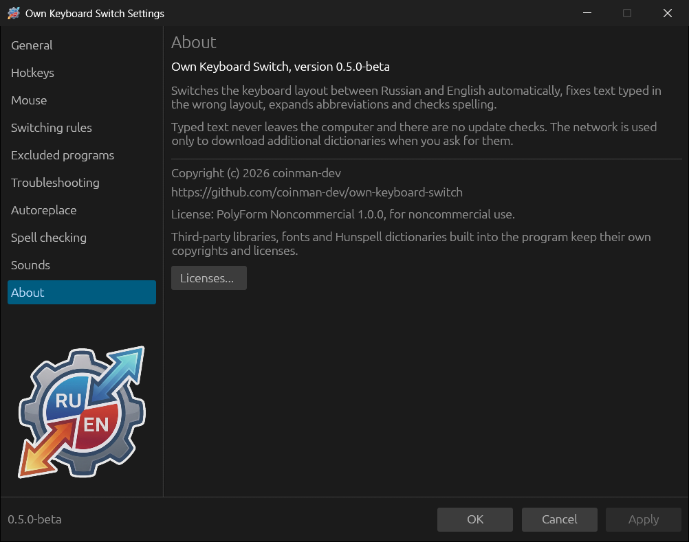

# Troubleshooting, sounds, about

## Troubleshooting

### Do not switch the layout if these were pressed before typing

If a selected key was pressed before a word, the word is not corrected
automatically: the program assumes you are editing the text yourself.

| Key | Default |
|---|---|
| **Backspace** | on |
| **Left arrow**, **Right arrow**, **Up arrow**, **Down arrow**, **Delete** | off |
| **You changed the layout** — the layout was switched by hand before the word | on |

### Other options

| Option | Default | What it does |
|---|---|---|
| **Only consider Russian and English layouts** | on | Input in other layouts (Ukrainian, German…) is not analysed |
| **Do not switch the layout on Tab and Enter** | off | A word finished with Tab or Enter is not checked — only with a space and punctuation |
| **Do not interact with excluded programs** | off | In [excluded programs](08-rules-and-exclusions.md#excluded-programs) neither the hotkeys nor autoreplace insertion work |

### Diagnostics

**Write a program diagnostic log** turns on the log in the `Logs` folder next
to the program (see [Files, folders and logs](14-files-and-logs.md)). **Log
mode**: **Error** — errors only, **Info** — normal, **Debug** — detailed, for
investigating a problem. Changes without a restart. Typed text and passwords
never get into the log: it holds only the program's decisions and their
reasons.

### Text analysis

- **Text analysis sensitivity** — a slider from **cautious** to **eager**. A
  cautious program switches only when the decision is confident and leaves
  words as they are more often; an eager one corrects doubtful words more
  often, but also makes mistakes more often. The default is in the middle.
- **Do not convert words shorter than, letters** — 1 by default, so one-letter
  words are corrected too (`z` → `я`). Set 2 or 3 if short words are
  corrected when they should not be.
- **Do not convert words with digits or mixed case (passwords)** — on.

### Retyping

- **Pause before retyping a word, ms** — between the layout change and the
  retyping (Windows — 30, Linux — 80). Increase it if in some program the
  corrected word appears in the old layout.
- **Pause between retyped keys, ms** — Windows 0, Linux 2. Increase it if the
  program loses letters while retyping.

## Sounds

**Sound effects** is the main switch (it is also in the tray menu). Below are
the events that play a sound:

| Event | Default |
|---|---|
| Automatic layout switch | on |
| Conversion by hotkey | on |
| Layout change | off |
| Conversion undone | on |
| Possible typo — what you typed does not look like a word, and there is nothing to correct it to | off |
| Autoreplace | on |
| Case corrected | on |
| Clipboard converted | on |
| Conversion error | on |
| Spelling error found | off |
| Spelling correction applied | on |

**Play a sound file** uses the built-in sounds or your own WAV file: select an
event, specify the file in the **Custom WAV file** field (**Browse...**) and
test it with the **Play** button. **Default** restores the built-in sound.
**System speaker beep** replaces all sounds with a short system beep.

## About

Version, purpose of the program, privacy and license information, a link to
the project. **Licenses...** shows the licenses of the built-in libraries,
fonts and dictionaries.
