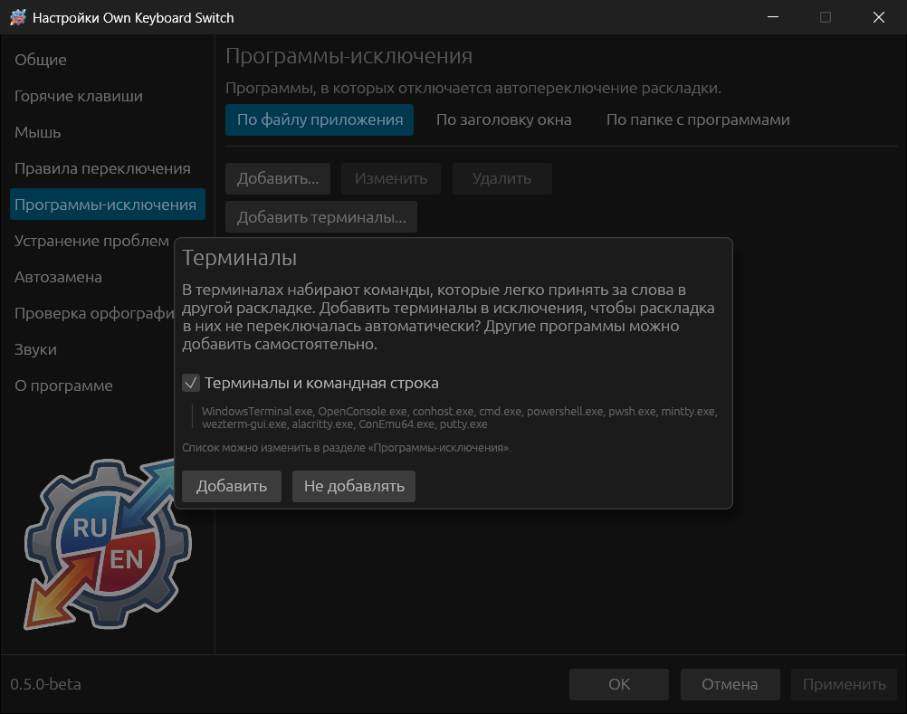
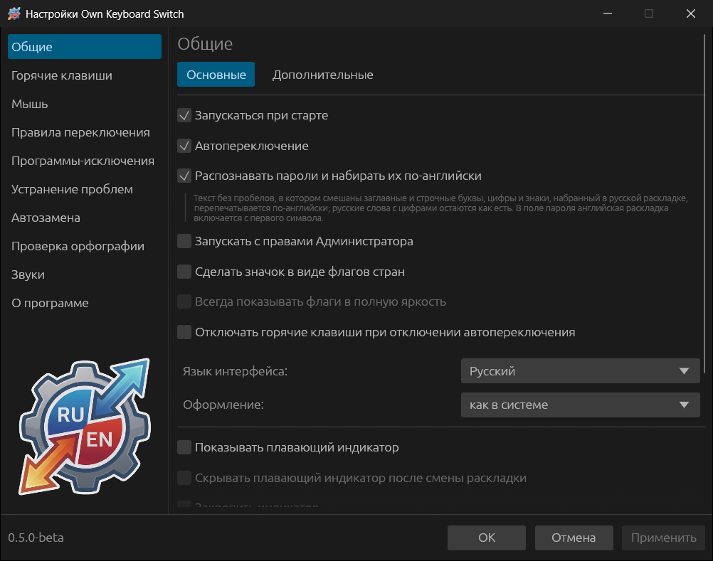

# Быстрый старт

## 1. Запустите программу

После запуска в области уведомлений появляется значок с текущей раскладкой.
Если его не видно, он может быть спрятан под стрелкой «Показать скрытые
значки»; перетащите его на панель задач, чтобы видеть раскладку всегда.

При первом запуске в Windows программа предлагает добавить терминалы в
исключения:

В терминалах набирают команды, которые легко принять за слова другой раскладки.
**Добавить** выключит автопереключение в Windows Terminal, PowerShell,
командной строке и других перечисленных программах. **Не добавлять** оставит
его везде; тогда команда, набранная в неправильной раскладке, исправится ещё до
того, как Enter дойдёт до терминала. Список потом меняется в разделе
[Программы-исключения](08-rules-and-exclusions.md#программы-исключения).

## 2. Попробуйте

Откройте любой текстовый редактор, включите английскую раскладку и наберите
`ghbdtn` и пробел. Слово сотрётся, раскладка переключится на русскую, и на
экране окажется «привет ». Наоборот работает так же: «руддщ» → `hello`.

Нажмите **Break** (на многих клавиатурах — Pause) сразу после исправления:
программа вернёт слово как было и раскладку тоже. Нажмите Break после слова,
которое программа не тронула, — она переведёт его в другую раскладку.

## 3. Откройте настройки

Дважды щёлкните значок в трее (в KDE Plasma — один раз) или выберите в его меню
**Настройки...**.

Изменения применяются кнопкой **Применить** или **ОК**; **Отмена** закрывает
окно без сохранения. Для начала стоит посмотреть:

- **Общие → Основные** — автозапуск, флаги в трее, язык и оформление окна;
- **Горячие клавиши** — если Break неудобна или её нет на клавиатуре;
- **Программы-исключения** — программы, где переключать не нужно (игры,
  удалённые рабочие столы, редакторы кода).

## 4. Если слово исправилось не так

- Нажмите **Break** — исправление отменится.
- Отмените одно и то же слово дважды подряд — программа предложит добавить
  правило, чтобы больше его не трогать. См.
  [Правила переключения](08-rules-and-exclusions.md#правила-переключения).
- Почему слово иногда остаётся как есть — в разделе
  [Как работает автопереключение](04-how-switching-works.md#когда-программа-не-вмешивается).
