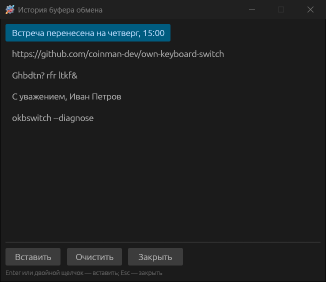

# Повседневная работа

## Значок в трее

Значок показывает текущую раскладку: буквы **RU**/**EN** или, если включено
**Сделать значок в виде флагов стран**, флаг. Когда автопереключение выключено,
значок становится серым или тусклым, а подсказка при наведении добавляет
«(автопереключение выключено)».

- **Двойной щелчок** — открыть настройки. В KDE Plasma настройки открываются
  одним щелчком, в GNOME меню — одним щелчком, настройки — двойным.
- **Одиночный щелчок** (Windows) — меню вставки
  [автозамены](09-autoreplace.md#список-и-меню-вставки), если в её настройках
  отмечено **Показывать список в меню**.
- **Правый щелчок** — меню:

| Пункт | Что делает |
|---|---|
| **Настройки...** | Открывает окно настроек |
| Список раскладок | Все установленные в системе раскладки с флагами; щелчок включает раскладку |
| **Системные настройки клавиатуры** | Открывает системный раздел языков и раскладок |
| **Автопереключение** | Включает и выключает автопереключение |
| **Звуковые эффекты** | Включает и выключает [звуки](11-troubleshooting-sounds-about.md#звуки) |
| **Буфер обмена →** | **Изменить раскладку**, **Транслитерировать**, **Проверить орфографию** текста в буфере; **Посмотреть историю...** |
| **Автозамена →** | **Список автозамены** и, если включено, сами записи — щелчок вставляет текст |
| **О программе** | Версия, лицензия, лицензии компонентов |
| **Выйти** | Завершает программу |

## Плавающий индикатор

**Общие → Основные → Показывать плавающий индикатор** выводит небольшой значок
раскладки поверх окон.

Индикатор не забирает фокус: его можно перетаскивать мышью, пока вы печатаете
в другом окне. Правый щелчок — меню **Закрепить индикатор**, **Настройки...**,
**Скрыть индикатор**; двойной щелчок открывает настройки. С опцией **Скрывать
плавающий индикатор после смены раскладки** он появляется на пару секунд после
каждой смены раскладки и прячется.

## Действия с выделенным текстом

Выделите текст в любой программе и нажмите сочетание. Программа копирует
выделение, преобразует его и вставляет обратно; прежнее содержимое буфера
обмена восстанавливается.

| Сочетание по умолчанию | Действие | Пример |
|---|---|---|
| **Shift+Break** | Сменить раскладку выделенного текста | `Ghbdtn? rfr ltkf&` → «Привет, как дела?» |
| **Alt+Break** | Сменить регистр выделенного текста | «пРИВЕТ» → «Привет» |
| **Alt+Scroll Lock** | Транслитерировать выделенный текст | «Привет» ↔ `Privet` |
| **Ctrl+Alt+V** | Вставка текста без форматирования | Вставляет буфер как обычный текст |
| не назначено | Преобразовать число в текст | `458` → «Четыреста пятьдесят восемь», `247-23` → «Двести сорок семь рублей 23 копейки» |
| не назначено | Добавить выделенный текст в автозамену | Открывает новую запись автозамены с этим текстом |

Сочетания меняются в разделе [Горячие клавиши](07-hotkeys-and-mouse.md).

## Буфер обмена

Те же преобразования работают с текстом, уже скопированным в буфер: меню трея
**Буфер обмена → Изменить раскладку / Транслитерировать / Проверить
орфографию** или горячие клавиши «Сменить раскладку буфера обмена»,
«Транслитерировать текст в буфере обмена». Результат кладётся обратно в буфер;
если включено **Показывать окно с результатами конвертации буфера**
([Общие → Дополнительные](06-general-settings.md#дополнительные)), он ещё и
показывается в окне с кнопкой **Скопировать результат**.

### История буфера обмена

Пока включено **Следить за буфером обмена**, программа помнит последние 30
скопированных текстов. Окно истории открывается пунктом меню трея **Буфер
обмена → Посмотреть историю...** или горячей клавишей «Показать историю буфера
обмена».

Enter или двойной щелчок вставляют выбранную запись в окно, где вы печатали;
**Очистить** забывает все записи; Esc закрывает окно. Повторно скопированный
текст поднимается в начало списка.

По умолчанию история живёт только до выхода из программы. Опция **Сохранять
историю буфера обмена после перезагрузки** записывает её в файл
`data\clipboard-history.txt`. Содержимое не фильтруется: скопированный пароль
тоже окажется в файле, поэтому включайте её осознанно.

## Запятая по двойному пробелу

С опцией **Запятая по двойному нажатию клавиши Пробел** быстрое двойное нажатие
пробела после слова ставит запятую и пробел — удобно в русской раскладке, где
запятая требует Shift.
