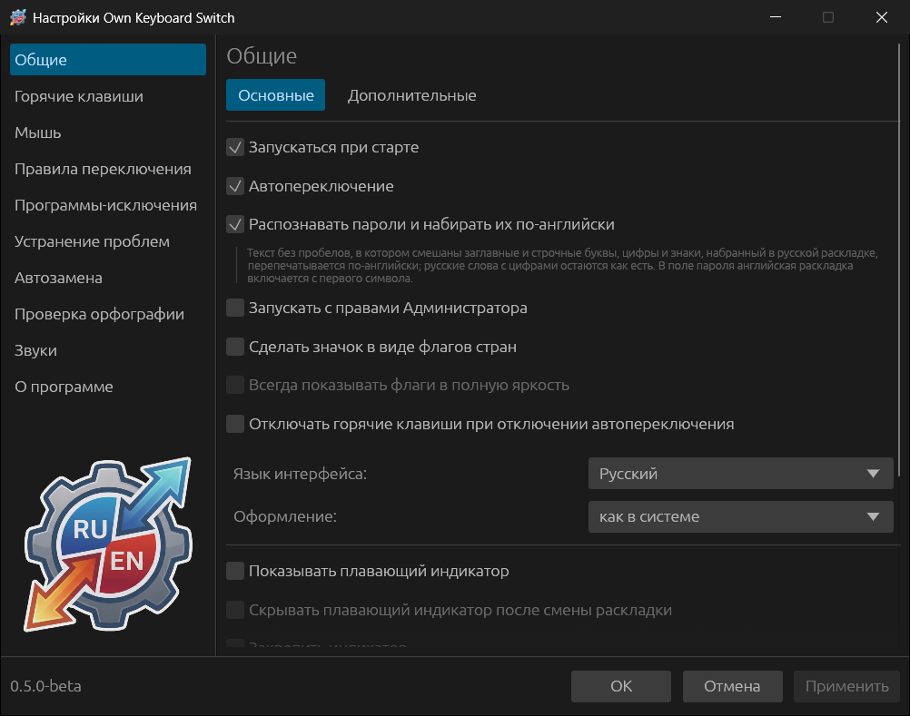
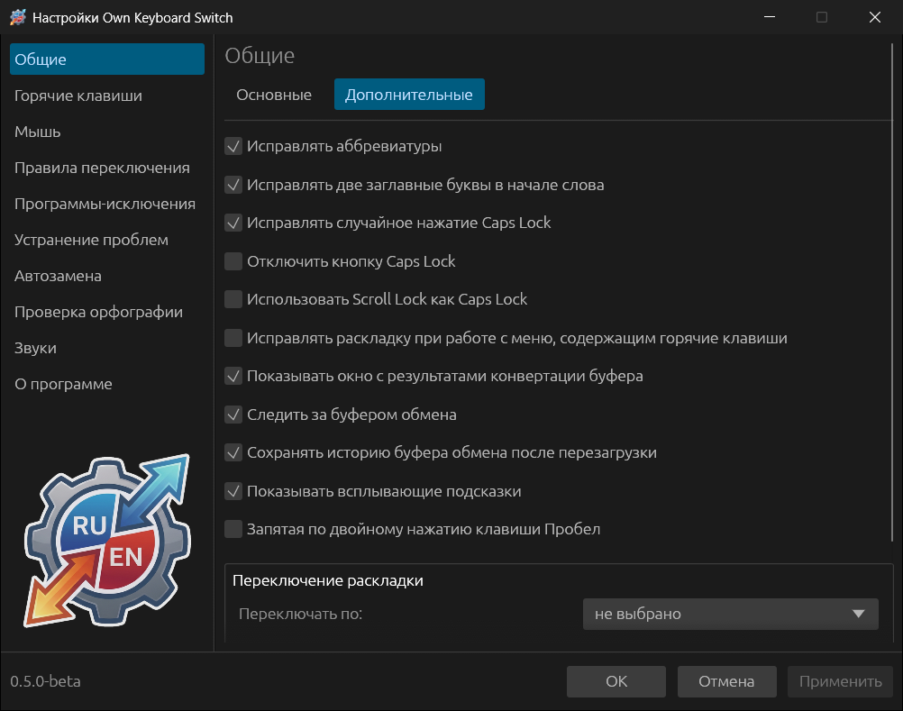
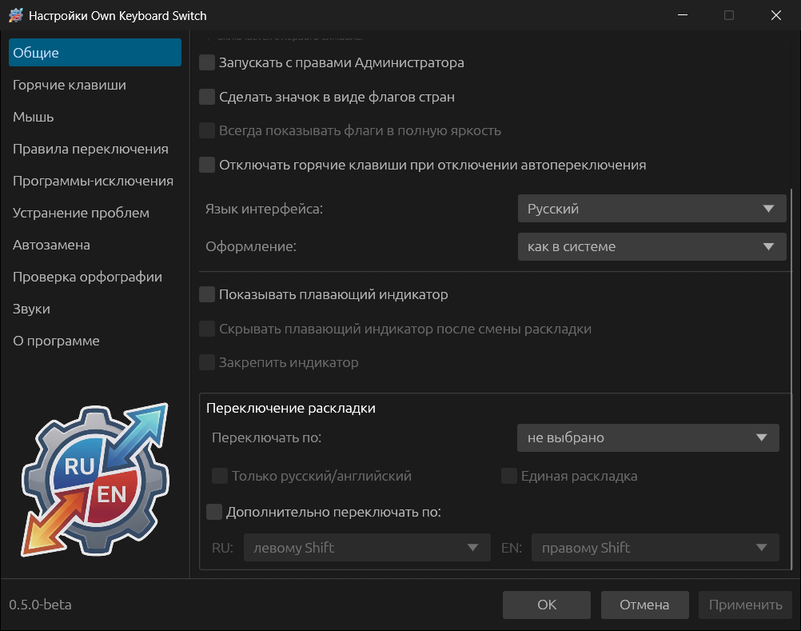

# Общие настройки

Раздел **Общие** состоит из вкладок **Основные** и **Дополнительные**; в Linux
есть ещё вкладка **Для Linux**. Под обеими первыми вкладками внизу находится
блок **Переключение раскладки**.

## Основные

| Опция | По умолчанию | Что делает |
|---|---|---|
| **Запускаться при старте** | вкл. | Запуск при входе в систему. В Windows — запись в автозагрузке пользователя, в Linux — файл в `~/.config/autostart/` |
| **Автопереключение** | вкл. | Главный выключатель автоматического исправления. Break и остальные горячие клавиши работают и без него |
| **Распознавать пароли и набирать их по-английски** | вкл. | См. [Пароли](04-how-switching-works.md#пароли) |
| **Запускать с правами Администратора** | выкл. | Только Windows. Нужна, чтобы программа работала в окнах, запущенных от имени администратора. После **Применить** программа предложит перезапуститься с одним запросом UAC. С автозапуском регистрация переносится в планировщик заданий, чтобы при входе в систему UAC не спрашивал |
| **Настраивать доступ к клавиатуре при запуске** | вкл. | Только Linux. Если доступа к клавиатуре нет, при запуске открывается окно настройки |
| **Сделать значок в виде флагов стран** | выкл. | Флаг вместо букв RU/EN в трее. Ниже появляется список **Флаг для каждой раскладки** — для каждой установленной раскладки можно выбрать свой флаг |
| **Всегда показывать флаги в полную яркость** | выкл. | Не приглушать флаг, когда автопереключение выключено |
| **Отключать горячие клавиши при отключении автопереключения** | выкл. | Вместе с автопереключением выключаются и все сочетания клавиш программы |
| **Язык интерфейса** | Автоматически | Русский или английский; «Автоматически» берёт язык интерфейса системы. Меняется без перезапуска |
| **Оформление** | как в системе | Светлое, тёмное или как в системе |
| **Показывать плавающий индикатор** | выкл. | См. [Плавающий индикатор](05-everyday-use.md#плавающий-индикатор) |
| **Скрывать плавающий индикатор после смены раскладки** | выкл. | Индикатор появляется на 2 секунды после смены раскладки |
| **Закрепить индикатор** | выкл. | Индикатор нельзя сдвинуть мышью |

## Дополнительные

| Опция | По умолчанию | Что делает |
|---|---|---|
| **Исправлять аббревиатуры** | вкл. | Переводить слова из заглавных букв: «ШЫЩ» → `ISO`. Выключите, если такие слова чаще бывают нарочно |
| **Исправлять две заглавные буквы в начале слова** | вкл. | «ПРивет» → «Привет» |
| **Исправлять случайное нажатие Caps Lock** | вкл. | «пРИВЕТ» → «Привет» и выключение Caps Lock |
| **Отключить кнопку Caps Lock** | выкл. | Caps Lock перестаёт действовать |
| **Использовать Scroll Lock как Caps Lock** | выкл. | Scroll Lock включает и выключает режим заглавных букв |
| **Исправлять раскладку при работе с меню, содержащим горячие клавиши** | выкл. | Только Windows. При нажатии Alt раскладка временно подстраивается под буквы меню окна, чтобы Alt+Ф открывал «Файл», а Alt+F — «File». Работает в программах с обычным системным меню |
| **Показывать окно с результатами конвертации буфера** | вкл. | После преобразования буфера показывать окно с результатом |
| **Следить за буфером обмена** | вкл. | Вести [историю буфера обмена](05-everyday-use.md#история-буфера-обмена) |
| **Сохранять историю буфера обмена после перезагрузки** | выкл. | Записывать историю в файл; содержимое не фильтруется |
| **Показывать всплывающие подсказки** | вкл. | Пояснения при наведении на элементы окна настроек |
| **Запятая по двойному нажатию клавиши Пробел** | выкл. | Два быстрых пробела после слова дают «, » |

## Переключение раскладки

Раскладку можно переключать одной клавишей вместо системного сочетания.

- **Переключать по:** правому или левому Ctrl, правому или левому Shift,
  Caps Lock, левому или правому Alt. Срабатывает короткое нажатие клавиши
  отдельно, без других клавиш; в сочетаниях клавиша работает как обычно.
  - **Только русский/английский** — переключать только между русской и
    английской раскладками, пропуская остальные установленные.
  - **Единая раскладка** — одна раскладка для всех окон: при переходе в другое
    окно в нём включается та же раскладка. В GNOME на Wayland не
    поддерживается.
- **Дополнительно переключать по:** отдельные клавиши для каждой раскладки —
  например, левый Shift включает русскую (**RU**), правый — английскую
  (**EN**).

## Для Linux

Вкладка есть только в Linux; подробности — в разделе
[Linux](12-linux.md#вкладка-для-linux).

- **Способ переключения** — «Автоматический выбор» (XKB в X11, интеграция
  GNOME или KDE в Wayland) или явный выбор: «Система X11 (XKB)», «Рабочий стол
  KDE», «Расширение GNOME». Варианты «Комбинация GNOME» и «Внутренний учёт» пока
  недоступны.
- **Клавиатуры** — по одному пути устройства на строку
  (`/dev/input/event3` или ссылка из `/dev/input/by-id`). Пустой список — все
  доступные клавиатуры. Изменения применяются без перезапуска.
