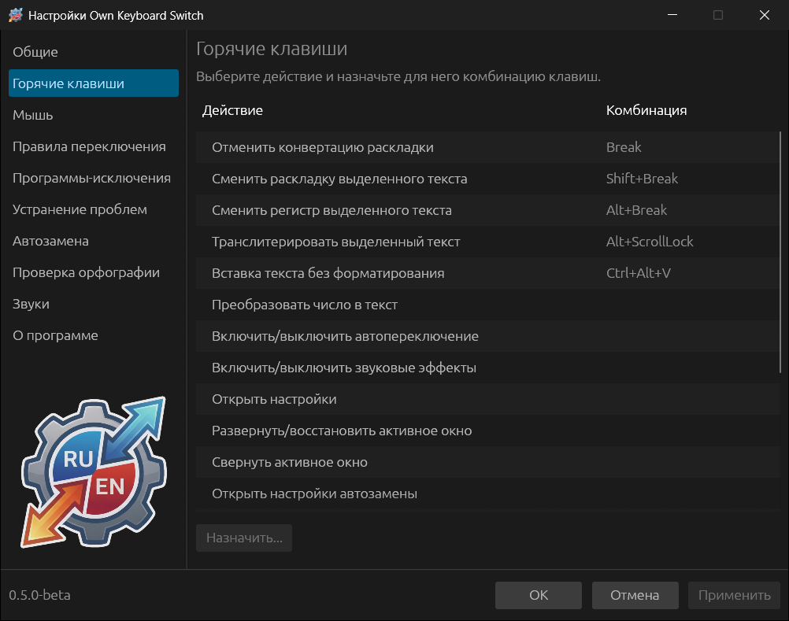
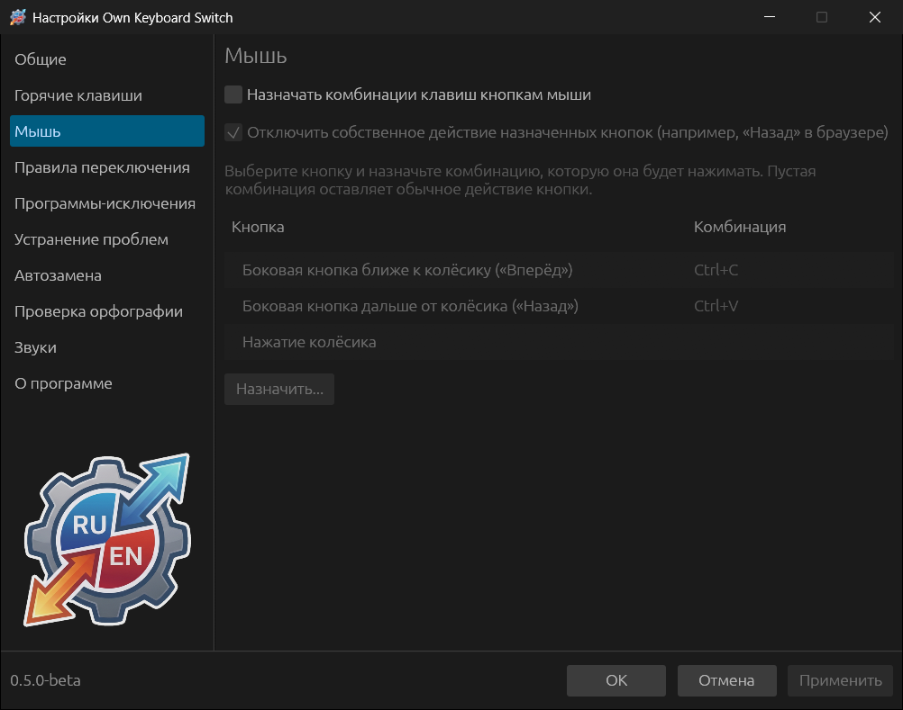

# Горячие клавиши и мышь

## Горячие клавиши

Выберите действие в списке и нажмите **Назначить...** (или дважды щёлкните
строку). В окне **Назначить комбинацию клавиш** нажмите нужное сочетание —
**Задать нажатием** — или введите его вручную, например `Ctrl+Alt+K`.
**Очистить** снимает назначение, Esc отменяет. Если сочетание уже занято другим
действием, окно предупредит об этом.

| Действие | По умолчанию | Что делает |
|---|---|---|
| Отменить конвертацию раскладки | Break | Отменяет последнее исправление или переводит слово вручную — см. [Клавиша Break](04-how-switching-works.md#клавиша-break) |
| Сменить раскладку выделенного текста | Shift+Break | `Ghbdtn` → «Привет» в выделении |
| Сменить регистр выделенного текста | Alt+Break | «пРИВЕТ» ↔ «Привет» |
| Транслитерировать выделенный текст | Alt+Scroll Lock | «Привет» ↔ `Privet` |
| Вставка текста без форматирования | Ctrl+Alt+V | Вставляет буфер как обычный текст |
| Преобразовать число в текст | — | `458` → «Четыреста пятьдесят восемь» |
| Включить/выключить автопереключение | — | То же, что пункт меню трея |
| Включить/выключить звуковые эффекты | — | То же, что пункт меню трея |
| Открыть настройки | — | Открывает это окно |
| Развернуть/восстановить активное окно | — | Для любого окна, как кнопка «Развернуть» |
| Свернуть активное окно | — | Для любого окна |
| Открыть настройки автозамены | — | Открывает раздел «Автозамена» |
| Показать/скрыть список автозамены | — | Постоянный список, см. [Автозамена](09-autoreplace.md#список-и-меню-вставки) |
| Показать меню вставки автозамены | — | Заменяет набранное сокращение или открывает выбор записи |
| Добавить выделенный текст в автозамену | — | Новая запись автозамены с выделенным текстом |
| Показать историю буфера обмена | — | См. [История буфера обмена](05-everyday-use.md#история-буфера-обмена) |
| Сменить раскладку буфера обмена | — | Переводит текст в буфере |
| Транслитерировать текст в буфере обмена | — | Транслитерирует текст в буфере |
| Проверить орфографию выделения или буфера обмена | — | См. [Проверка орфографии](10-spellcheck.md) |

Сочетания действуют во всех программах. Если включено **Общие → Основные →
Отключать горячие клавиши при отключении автопереключения**, они не работают,
пока автопереключение выключено.

Break на ноутбуках часто нет или она доступна только через Fn. Назначьте
«Отменить конвертацию раскладки» другое сочетание.

## Мышь

Кнопкам мыши можно назначить сочетания клавиш, которые они будут «нажимать».

1. Отметьте **Назначать комбинации клавиш кнопкам мыши**.
2. Выберите кнопку — **Боковая кнопка ближе к колёсику («Вперёд»)**, **Боковая
   кнопка дальше от колёсика («Назад»)** или **Нажатие колёсика** — и нажмите
   **Назначить...**. Изначально предложены Ctrl+C и Ctrl+V для боковых кнопок.
3. **Отключить собственное действие назначенных кнопок** (включено) — чтобы,
   например, «Назад» в браузере не уходил на предыдущую страницу. Кнопка с
   пустой комбинацией сохраняет обычное действие.

Кнопка мыши нажимает сочетание для активной программы. Сочетания самой
Own Keyboard Switch (например, Break) так вызвать нельзя: собственные нажатия
программа не обрабатывает.
