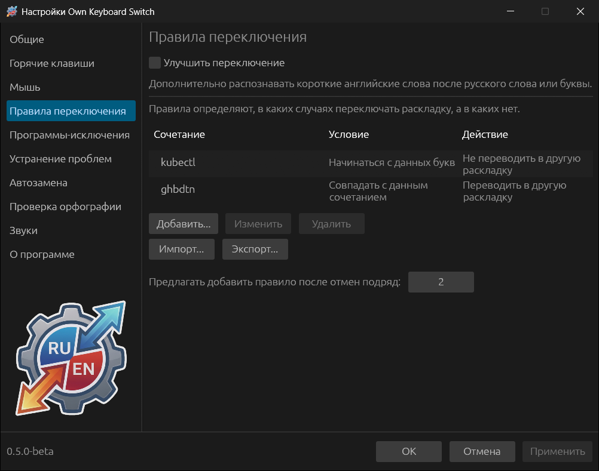
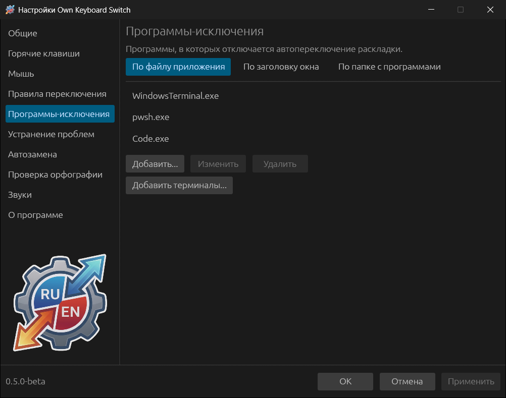

# Правила и программы-исключения

## Правила переключения

Правило говорит программе, что делать со словами, в которых встречается
заданное сочетание букв, и действует раньше словарей и статистики.

Нажмите **Добавить...** и заполните окно **Правило переключения**:

- **Слово или сочетание букв** — в любой раскладке: правило сравнивается с
  обоими прочтениями слова, поэтому `ghbdtn` и «привет» дают одно и то же
  правило. Совет: укажите характерную часть слова без окончания.
- **Условие** — слово должно **Содержать данное сочетание букв**,
  **Начинаться с данных букв** или **Совпадать с данным сочетанием**.
- **Учитывать регистр** — если отмечено, `Git` и `git` различаются.
- **Действие** — **Переводить в другую раскладку** или **Не переводить в
  другую раскладку**.

Примеры:

| Сочетание | Условие | Действие | Зачем |
|---|---|---|---|
| `kubectl` | Начинаться с данных букв | Не переводить | Команда и её формы остаются как набраны |
| `ghbdtn` | Совпадать с данным сочетанием | Переводить | Всегда исправлять именно это слово |

**Изменить** и **Удалить** работают с выбранной строкой; двойной щелчок по
строке тоже открывает её для правки.

### Правило после отмен

Если одно и то же слово отменено клавишей Break несколько раз подряд, программа
спрашивает: «Вы несколько раз подряд отменили конвертацию этого слова. Добавить
правило?» — и открывает окно правила с уже заполненным словом. Число отмен
задаёт **Предлагать добавить правило после отмен подряд** (по умолчанию 2).

### Импорт и экспорт

**Экспорт...** сохраняет правила в файл TOML, **Импорт...** добавляет правила из
такого файла в список: новые добавляются, совпадающие обновляются. Можно
импортировать и целый `config.toml` другой установки — из него возьмутся только
правила. После импорта нажмите **Применить**.

### Улучшить переключение

**Улучшить переключение** (вверху раздела, выключено по умолчанию) дополнительно
распознаёт короткие английские слова в 2–3 буквы после русского слова или
отдельной буквы: «я купил шыщ» → «я купил iso». Русские слова, имена и названия
защищены. Правила пользователя важнее этой опции.

## Программы-исключения

В программах из этого списка автоматические исправления не выполняются:
автопереключение, исправление регистра, перепечатка паролей. Горячие клавиши
(Break, Shift+Break…) продолжают работать — если только не включено
**Устранение проблем → Не взаимодействовать с программами-исключениями**.

Программу можно указать тремя способами — по вкладкам:

| Вкладка | Что указать | Пример |
|---|---|---|
| **По файлу приложения** | Имя файла или полный путь. Имя без пути подходит к программе в любой папке. Регистр не важен | `WindowsTerminal.exe`, `C:\Games\game.exe` |
| **По заголовку окна** | Часть заголовка окна, **с учётом регистра** | `Visual Studio Code`, `- Remote Desktop` |
| **По папке с программами** | Папка: исключаются все программы в ней и во вложенных папках | `D:\Games` |

**Добавить терминалы...** открывает то же предложение, что и при первом запуске:
Windows Terminal, OpenConsole, conhost, cmd, PowerShell, pwsh, mintty, WezTerm,
Alacritty, ConEmu и PuTTY.

Что обычно добавляют: игры (там клавиши — это управление, а не текст),
удалённые рабочие столы и виртуальные машины (у них своя раскладка), редакторы
кода, если вы пишете в них в основном код.

В Linux программы определяются по имени исполняемого файла или app_id окна. В
GNOME на Wayland для этого нужно расширение GNOME Shell из комплекта программы;
без него раздел показывает предупреждение.
