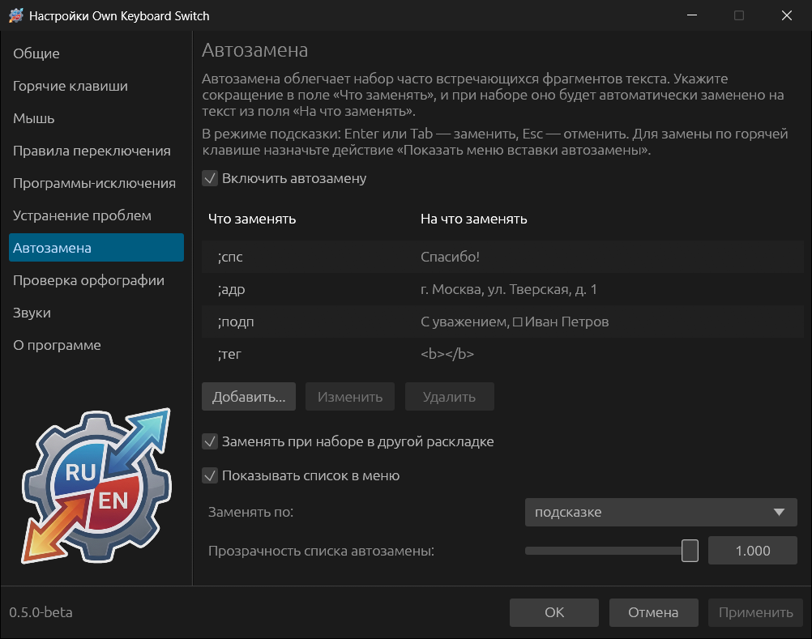
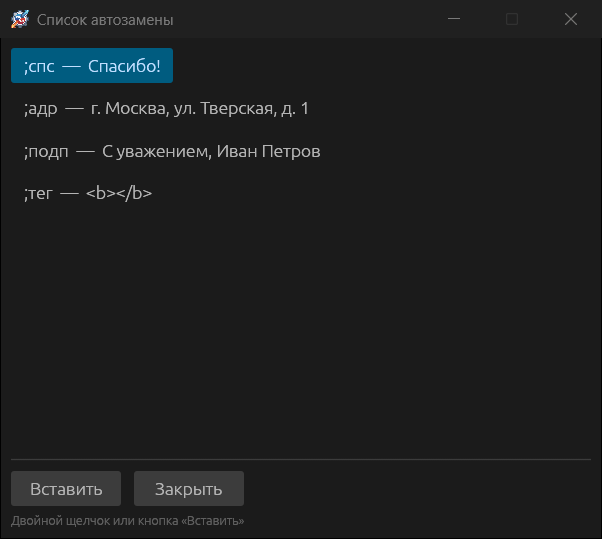
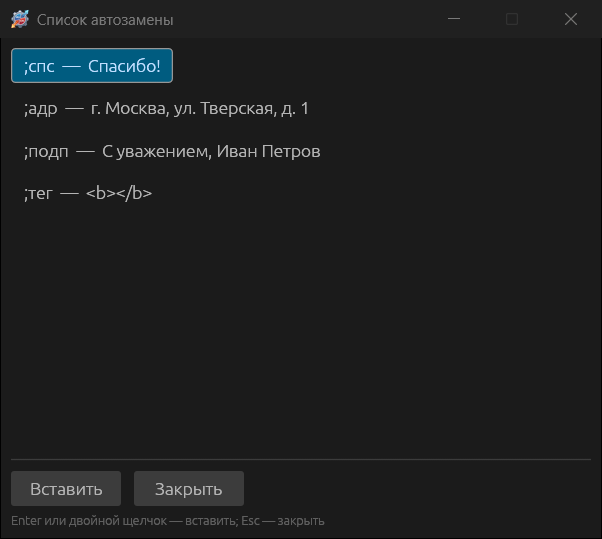

# Автозамена

Автозамена разворачивает сокращения в готовый текст: набрали `;адр` — получили
адрес целиком. По умолчанию она выключена.

## Записи

Отметьте **Включить автозамену** и нажмите **Добавить...**. В окне записи:

- **Что заменять** — сокращение. Удобно начинать его с символа, который не
  встречается в обычных словах (`;спс`, `;адр`), чтобы замена не срабатывала
  случайно.
- **На что заменять** — текст замены; может быть многострочным.
- **Запоминать позицию курсора** — после вставки курсор встанет не в конец, а в
  то место текста замены, где он стоял при редактировании (или задайте **Курсор
  после символа номер**). Например, для `<b></b>` курсор окажется между тегами.

Записи можно добавлять и из любой программы: выделите текст и нажмите сочетание
«Добавить выделенный текст в автозамену» (назначается в
[Горячих клавишах](07-hotkeys-and-mouse.md)). Откроется новая запись с этим
текстом; останется придумать сокращение.

## Когда происходит замена

**Заменять по:**

| Режим | Как работает |
|---|---|
| **подсказке** (по умолчанию) | Когда набранное совпадает с сокращением, рядом с курсором появляется подсказка с текстом замены. **Enter** или **Tab** — заменить, **Esc** — оставить как есть. Подсказка не забирает фокус |
| **Пробелу** | Сокращение заменяется, когда после него нажат пробел; пробел остаётся после вставленного текста |
| **Enter** / **Tab** | Сокращение заменяется по Enter или Tab; сама клавиша в программу не передаётся |
| **горячей клавише** | Замена по сочетанию «Показать меню вставки автозамены»: если перед курсором набрано сокращение, оно заменяется, иначе открывается меню выбора записи |

**Заменять при наборе в другой раскладке** (включено) — сокращение узнаётся и
тогда, когда набрано не в той раскладке: «адр» в английской раскладке
выглядит как `flh`, но тоже будет заменено.

## Список и меню вставки

Записи можно вставлять и без сокращений.

**Список автозамены** — постоянное окно, которое не забирает фокус у вашей
программы. Открывается пунктом меню трея **Автозамена → Список автозамены** или
сочетанием «Показать/скрыть список автозамены». Двойной щелчок по записи или
кнопка **Вставить** вставляют текст туда, где вы печатали. **Прозрачность списка
автозамены** задаётся ползунком в настройках.

**Меню вставки** — временное окно выбора у курсора: сочетание «Показать меню
вставки автозамены» (если перед курсором нет сокращения) или одиночный щелчок
по значку в трее (Windows). **Enter** или двойной щелчок вставляют запись,
**Esc** закрывает меню.

С опцией **Показывать список в меню** записи перечислены и в меню трея
**Автозамена**: щелчок по записи вставляет её.

В полях паролей и в программах, исключённых с опцией **Не взаимодействовать с
программами-исключениями**, текст не вставляется.
