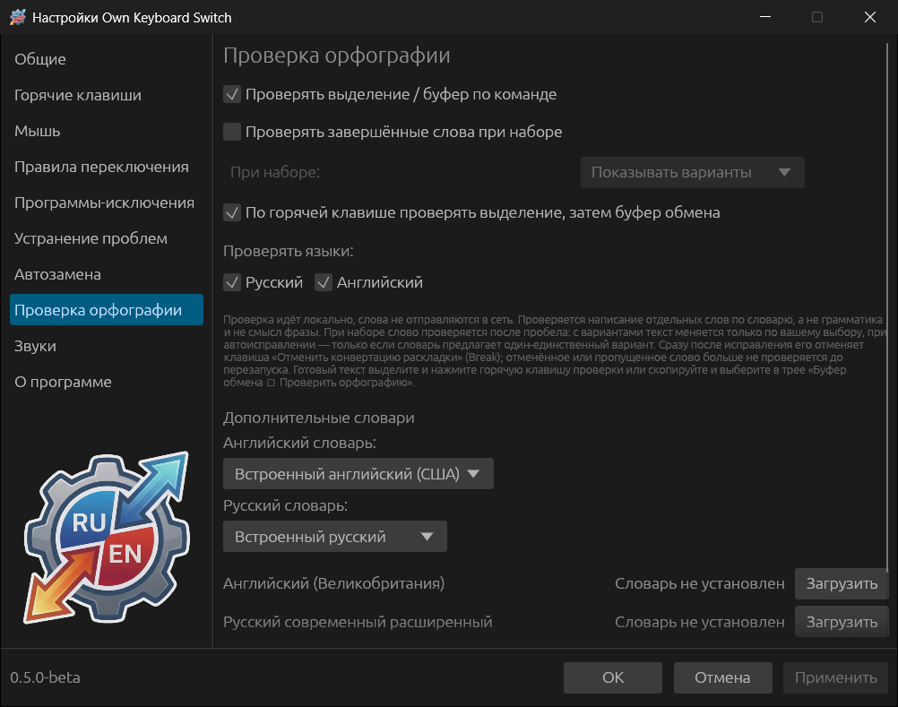
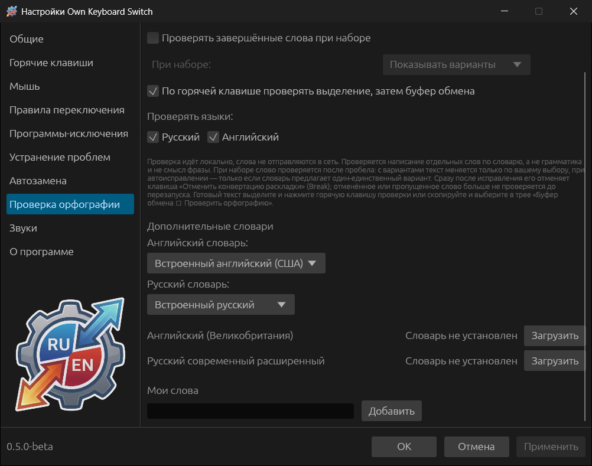

# Проверка орфографии

Проверка идёт на компьютере, слова не отправляются в сеть. Проверяется
написание отдельных слов по словарю Hunspell, а не грамматика и не смысл
фразы.

## Проверка готового текста

Включено по умолчанию (**Проверять выделение / буфер по команде**).

- Выделите текст и нажмите сочетание «Проверить орфографию выделения или
  буфера обмена» (назначается в [Горячих клавишах](07-hotkeys-and-mouse.md)).
  С опцией **По горячей клавише проверять выделение, затем буфер обмена**
  проверяется выделение, а если его нет — текст в буфере.
- Или скопируйте текст и выберите в меню трея **Буфер обмена → Проверить
  орфографию**.

Окно **Проверка орфографии** показывает найденные слова с вариантами. Выберите
нужные варианты (или **Выбрать первые подсказки**), просмотрите **Результат** и
нажмите **Скопировать результат** — исправленный текст окажется в буфере.

## Проверка при наборе

**Проверять завершённые слова при наборе** (выключено по умолчанию) проверяет
каждое слово после пробела. Режим **При наборе**:

- **Показывать варианты** — у курсора появляется окно «Возможная
  орфографическая ошибка» с вариантами; текст меняется, только если вы выберете
  вариант. **Оставить как есть**, **Пропустить** и **Добавить в мой словарь**
  оставляют слово.
- **Автоисправление только однозначных ошибок** — слово исправляется само, но
  только если словарь предлагает ровно один вариант.

Сразу после исправления Break отменяет его. Отменённое или пропущенное слово
больше не проверяется до перезапуска программы. В терминалах слова при наборе
не проверяются: команды и их параметры — не слова словаря.

## Языки и словари

- **Проверять языки** — русский и английский; можно оставить один.
- **Английский словарь** — встроенный английский (США) или английский
  (Великобритания).
- **Русский словарь** — встроенный русский или «Русский современный
  расширенный».

Дополнительные словари скачиваются кнопкой **Загрузить**. **Удалить** убирает
скачанный словарь.

**Мои слова** — свои слова, которые не считаются ошибками: введите слово и
нажмите **Добавить**. Сюда же попадают слова, добавленные кнопкой **Добавить в
мой словарь**.

Звуки «Найдена орфографическая ошибка» и «Орфографическая ошибка исправлена»
настраиваются в разделе [Звуки](11-troubleshooting-sounds-about.md#звуки).
