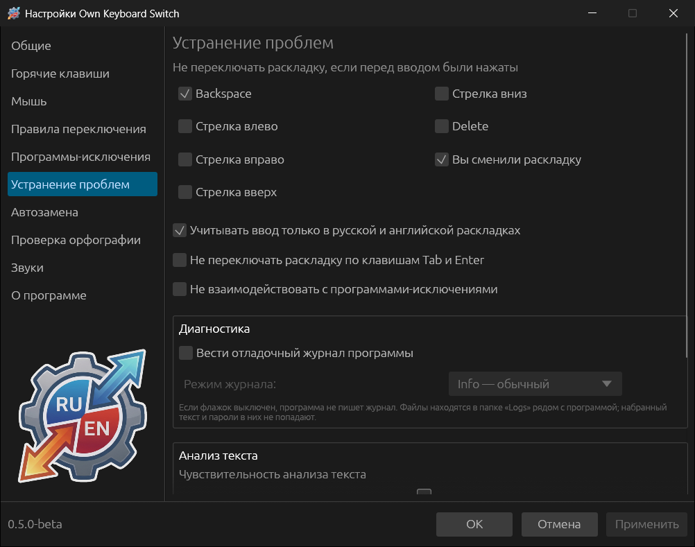
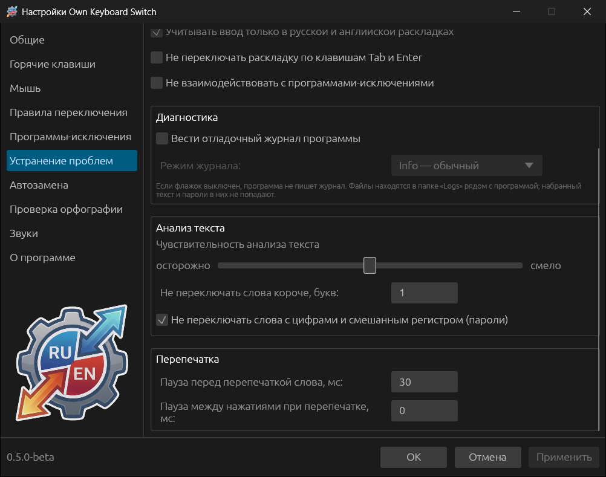
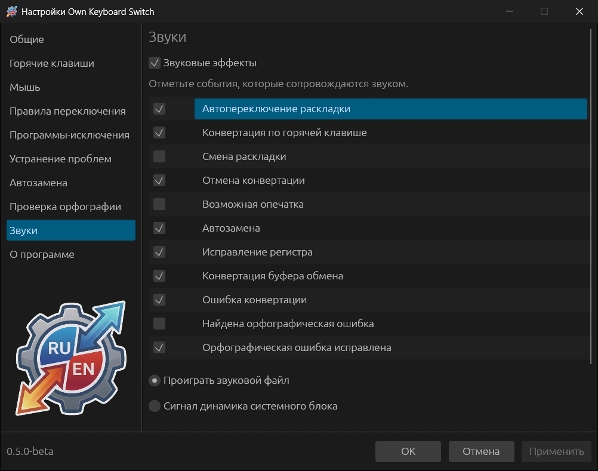
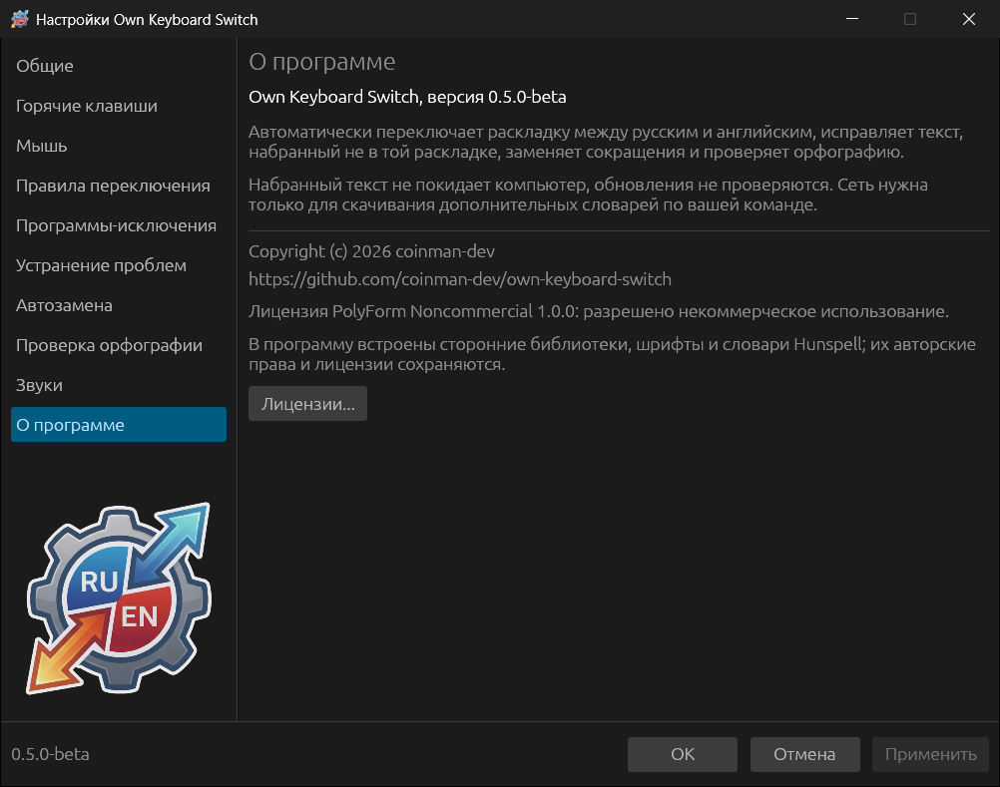

# Устранение проблем, звуки, о программе

## Устранение проблем

### Не переключать раскладку, если перед вводом были нажаты

Если перед словом нажата отмеченная клавиша, слово не исправляется
автоматически: программа считает, что вы правите текст сами.

| Клавиша | По умолчанию |
|---|---|
| **Backspace** | вкл. |
| **Стрелка влево**, **вправо**, **вверх**, **вниз**, **Delete** | выкл. |
| **Вы сменили раскладку** — раскладку перед словом переключили вручную | вкл. |

### Прочие опции

| Опция | По умолчанию | Что делает |
|---|---|---|
| **Учитывать ввод только в русской и английской раскладках** | вкл. | В других раскладках (украинской, немецкой…) ввод не анализируется |
| **Не переключать раскладку по клавишам Tab и Enter** | выкл. | Слово, законченное Tab или Enter, не проверяется — только пробелом и знаками |
| **Не взаимодействовать с программами-исключениями** | выкл. | В [программах-исключениях](08-rules-and-exclusions.md#программы-исключения) не работают и горячие клавиши, и вставка автозамены |

### Диагностика

**Вести отладочный журнал программы** включает журнал в папке `Logs` рядом с
программой (см. [Файлы, папки и журналы](14-files-and-logs.md)). **Режим
журнала**: **Error** — только ошибки, **Info** — обычный, **Debug** — подробный,
для разбора ошибки. Меняется без перезапуска. Набранный текст и пароли в журнал
не попадают: в нём только решения программы и их причины.

### Анализ текста

- **Чувствительность анализа текста** — ползунок от **осторожно** до **смело**.
  Осторожная программа переключает только при уверенном решении и чаще
  оставляет слова как есть; смелая чаще исправляет сомнительные слова, но и
  ошибается чаще. По умолчанию — посередине.
- **Не переключать слова короче, букв** — по умолчанию 1, то есть исправляются
  и однобуквенные слова (`z` → «я»). Поставьте 2 или 3, если короткие слова
  исправляются лишний раз.
- **Не переключать слова с цифрами и смешанным регистром (пароли)** — включено.

### Перепечатка

- **Пауза перед перепечаткой слова, мс** — между сменой раскладки и
  перепечаткой (Windows — 30, Linux — 80). Увеличьте, если в какой-то программе
  исправленное слово появляется в старой раскладке.
- **Пауза между нажатиями при перепечатке, мс** — Windows 0, Linux 2.
  Увеличьте, если программа теряет буквы при перепечатке.

## Звуки

**Звуковые эффекты** — общий выключатель (он же есть в меню трея). Ниже —
события, которые сопровождаются звуком:

| Событие | По умолчанию |
|---|---|
| Автопереключение раскладки | вкл. |
| Конвертация по горячей клавише | вкл. |
| Смена раскладки | выкл. |
| Отмена конвертации | вкл. |
| Возможная опечатка — набранное не похоже на слово, а исправить его не на что | выкл. |
| Автозамена | вкл. |
| Исправление регистра | вкл. |
| Конвертация буфера обмена | вкл. |
| Ошибка конвертации | вкл. |
| Найдена орфографическая ошибка | выкл. |
| Орфографическая ошибка исправлена | вкл. |

**Проиграть звуковой файл** использует встроенные звуки или ваш файл WAV:
выберите событие, укажите файл в поле **Свой звуковой файл WAV** (**Обзор...**)
и проверьте кнопкой **Проиграть**. **По умолчанию** возвращает встроенный звук.
**Сигнал динамика системного блока** заменяет все звуки коротким системным
сигналом.

## О программе

Версия, назначение программы, сведения о конфиденциальности и лицензии, ссылка
на проект. **Лицензии...** показывает лицензии встроенных библиотек, шрифтов и
словарей.
